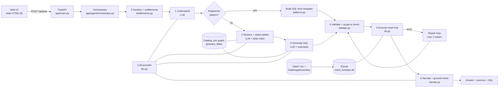

# Architecture: Talk to Data (Fund Operations Control Tower)

A natural-language-to-SQL assistant for fund operations. A user asks a business question in plain English. The system resolves the business words to schema values, writes and validates one read-only SQL query, runs it, and returns a source-linked answer: the interpreted question, the tables used and why, the exact SQL, a result table, KPI cards, a short narrative and an optional chart.

Core principle: **numbers come from SQL, never from model memory.** The LLM proposes; deterministic code validates, scopes, executes and checks.

## 1. High-level view



## 2. File map

| Path | Responsibility |
|---|---|
| `app/main.py` | FastAPI app factory. Routes: `GET /health`, `GET /api/config`, `GET /api/users`, `GET /api/schema`, `POST /api/ask`, `GET /` (UI). Maps errors to JSON codes. |
| `app/config.py` | Settings from environment. Key lookup order: `LLM_API_KEY`, `GROQ_API_KEY`, `GROK_API_DEV_KEY`. Redacts the key from logs. |
| `app/llm.py` | Provider-agnostic LLM client (Groq SDK or any OpenAI-compatible endpoint). Tolerant JSON parsing, retry with backoff, per-stage token budgets. Also a scripted test double. |
| `app/db.py` | Builds SQLite from the CSVs (original + synthetic overlay). Read-only connection with a SQLite authorizer, function allowlist, row cap and timeout. |
| `app/metadata.py` | `Catalog` (tables, columns, PK/FK, join graph, glossary), `AliasIndex` (entity resolution), `DateContext` (today, yesterday, months). |
| `app/glossary.json` | Business rules (tight cash, aged break, SLA risk, stale price...), table roles, SQL rules, alias extras. |
| `app/entitlements.py` | Mock users and fund scoping. Strips forbidden fund names from the question and rewrites the SQL AST to filter by `fund_id`. |
| `app/models.py` | Pydantic request/response and per-stage output schemas. |
| `app/agent/orchestrator.py` | The 6-stage pipeline, repair loop, provenance (`sources`) and response assembly. |
| `app/agent/prompts.py` | Prompt builders for understand, resolve, generate (+repair) and narrate. |
| `app/agent/retrieval.py` + `example_bank.json` | Question to SQL examples; TF-IDF retrieval of the 3 most similar. |
| `app/agent/patterns.py` | Model-independent SQL templates for YoY revenue decomposition (Q8) and fund attention ranking (Q10). |
| `app/agent/validate.py` | sqlglot validator: single SELECT only, table/column/function allowlists, fund scoping. |
| `app/agent/narrate.py` | KPI builder, number-grounding check, currency and month-to-date warnings, chart recipes. |
| `app/agent/memory.py` | Per-session history so follow-ups work. |
| `app/static/` | `index.html`, `app.js`, `styles.css`: the chat UI. |
| `scripts/` | `generate_supplementary_data.py`, `eval_models.py` (multi-model comparison). |
| `tests/` | Unit tests, golden tests (exact expected rows) and the live evaluation. |
| `Data/` | Original CSVs (never modified). `Data/supplementary/` holds deterministic synthetic extensions. |

## 3. Request lifecycle

`POST /api/ask` with `{question, session_id?, user_id}` calls `Orchestrator.ask()`.

### Stage 0: sanitize and entitlements
`sanitize_question()` runs the alias index over the question. Any **fund the user is not entitled to** is replaced by the placeholder `[a fund you cannot access]` *before any LLM sees the text*. If the whole question was about a forbidden fund, the response is `route: "denied"` with no query run.

### Stage 1: understand (LLM)
The model classifies the intent (`lookup`, `kpi`, `exception`, `trend`, `insight`, `summary`), rewrites a follow-up into a **standalone question** using session history, and lists time references (`today`, `yesterday`, `last_month`...). These time words are shown to the user as part of the interpreted question, resolved to real dates, for example "yesterday = 2026-09-04". If the model returns unusable output, the raw question is used. If the question is unanswerable, the user gets a clarification message.

### Pattern route (optional shortcut)
`match_pattern()` checks the question with regexes. "Which funds need attention" maps to the attention-ranking template (Q10), and revenue plus a year-on-year or "why/driver" cue maps to the revenue decomposition (Q8). The SQL is built from a template with validated parameters (dates and `F###` fund ids only), so these two work even if the model is weak or down. If a pattern fails it falls back to the LLM path.

### Stage 2: resolve entities and choose tables
Entity resolution is done in two layers, code first, then model.

1. **Deterministic alias index** (`AliasIndex.find`). Built once from the database. It matches longest alias first, with word boundaries and no overlaps:
   - Funds: full name, name without the "MS " prefix and " Fund" suffix, the fund id, and "EM" for "Emerging Markets". "US Core Bond" resolves to `F004`.
   - Counterparties: full name, id (`B01`), and a unique first word. "Helios" resolves to Helios Securities.
   - Fail codes: `LACK`, `LATE`, `CMIS`, `MISM`, `CLAC`, plus glossary aliases such as "short" meaning `LACK`.
   - Processes (for example "NAV Publication") and securities by name.
2. **LLM resolve stage.** The model receives the compact schema, the join graph (with "do not join" warnings), the code-recognised entities and the date context. It returns which tables are needed and **a one-line reason for each**, plus the join keys and key columns. This is the source of the "why" shown for each table.

Business words become rules through `glossary.json`: tight cash is `cash_pct_aum < 2.0`, aged break is Open and `age_days > 5`, SLA risk is Pending and `pct_of_sla >= 80`, stale price is Open and `stale_days >= 2`, and so on. Dates come from `DateContext`, never hardcoded: "today" is the data's latest date, "yesterday" is the latest settlement day.

### Stage 3: generate SQL (LLM)
The prompt combines the schema, join graph, glossary, date context, the suggested tables, the recognised entities, the last turn (for follow-ups) and **three retrieved examples** (TF-IDF over the example bank). Rules require SQLite dialect, `fund_id` joins and no cross-currency sums without a warning. The model returns JSON `{sql, assumptions}`. Assumptions are shown as warnings.

### Stage 4: validate and scope (`validate.py`)
The SQL is parsed with sqlglot and **re-emitted from the AST**, so what runs is what was checked. It must be a single `SELECT` or `WITH ... SELECT`. It is rejected for DDL/DML, `PRAGMA`/`ATTACH`, recursive CTEs, schema-qualified or system tables, table functions, unknown tables or columns, or any function outside the allowlist. The check counts distinct physical tables, not CTE references. For restricted users, every fund-scoped table is replaced by a subquery filtered on the user's `fund_ids`, and a second pass verifies nothing was missed (fails closed). Syntax or schema errors can be repaired; security rejections are final.

### Stage 5: execute and repair (`db.py`)
The query runs on a read-only SQLite connection with an authorizer, a row cap (500) and a timeout (5 s). On a schema or SQL error the error text goes back to the model for up to 2 repair attempts, bounded by a request deadline. Failures return a clear error code and the SQL that was tried.

### Stage 6: build the final answer
1. **Provenance (`_sources`).** For every table used, the response lists the reason (from the resolve stage, or from the pattern template), the columns actually used, the join conditions, and a `synthetic` flag for tables that come from the supplementary data.
2. **Warnings.** Truncated results, mixed-currency sums (a probe query checks whether the aggregate spans more than one `ccy`), month-to-date comparisons, assumptions and any entitlement note.
3. **Narrative.** The model sees only the returned rows and warnings and must quote numbers as they appear. If narration fails or times out, a deterministic sentence ("The query returned 5 rows.") is used instead.
4. **KPI cards.** The model only *points at* result cells or simple aggregates (`cell`, `sum`, `max`, `min`, `count_rows`); code reads the values and formats them, so a KPI can never contain an invented number.
5. **Grounding check (`check_grounding`).** Every number in the narrative (normalising `%`, `m`, `bn`, commas) must match a cell, a KPI or the row count. Dates and identifiers are ignored. Any number that does not match adds a warning such as "Narrative mentions 12% which is not in the query result."
6. **Chart.** Rule-based: a line chart for date-like first columns, a grouped bar for "current vs prior" columns, and a settlement-rate trend for settlement-rate questions.
7. **Memory.** The turn (standalone question, SQL, first rows, resolved entities, dates) is stored so a follow-up such as "Break yesterday's fails down by broker" inherits the same filters.

Response shape:

```json
{
  "session_id": "...", "interpreted_question": "... (yesterday = 2026-09-04)",
  "intent": "exception", "route": "llm | pattern:<name> | denied | clarification",
  "sources": [{"table": "fact_settlement", "why": "...", "columns": ["..."],
               "join_keys": ["fact_settlement.txn_id = fact_transaction.txn_id"], "synthetic": "no"}],
  "sql": "SELECT ...", "columns": ["..."], "rows": [[...]],
  "kpis": [{"label": "...", "value": 5, "display": "5", "unit": null}],
  "narrative": "...", "chart": null, "warnings": ["..."], "row_count": 5, "truncated": false
}
```

## 4. Worked example: "Break yesterday's fails down by broker" (after Q4)

1. **Sanitize:** no fund names, nothing removed.
2. **Understand:** a follow-up. Standalone question: "Break yesterday's failed settlements down by broker." Time reference `yesterday` resolves to 2026-09-04.
3. **Entities:** none typed. Context carries over from the previous turn.
4. **Tables:** `fact_settlement` (status and broker) and `fact_transaction` (trade value), joined on `txn_id`.
5. **SQL:** filter `status = 'Failed'` and `settlement_date` = yesterday, group by `broker_name`, count fails and sum `gross_amount`.
6. **Validate and run:** result is Helios Securities with 4 fails and Aurora Investment Bank with 1.
7. **Answer:** a table, KPI cards, a narrative built only from those rows, and a warning that the value column adds USD and EUR without FX conversion.

## 5. Data model and synthetic supplement

The star schema has 4 dimensions (`dim_fund`, `dim_security`, `dim_counterparty`, `dim_date`) and 9 facts (transaction, settlement, NAV, cash balance, flows, recon break, pricing exception, revenue, SLA). Join keys come from the PK/FK markers in `data_dictionary.csv`, plus `fact_settlement.broker_id` to `dim_counterparty.cp_id`, which the dictionary leaves unspecified. Columns that look like keys but are not (`recon_break.custodian`, `dim_date.month` versus the text `YYYY-MM` months) are listed as "do not join".

`Data/supplementary/` adds a deterministic synthetic layer (history for NAV and cash, FX rates, flow detail, SLA history, extra revenue and flow months). Original CSVs are never changed, the golden results are the same with or without it, and anything synthetic is flagged in the sources panel.

## 6. Safety model

| Layer | Control |
|---|---|
| Input | Forbidden fund names removed before any model call; question text is escaped and treated as untrusted data in prompts. |
| Validation | AST-based, single read-only statement, allowlists, SQL re-emitted from the AST. |
| Entitlements | Server-side AST rewrite plus verification; fails closed. |
| Database | Read-only connection, `query_only`, SQLite authorizer, row cap, timeout. |
| Output | Number-grounding check; KPIs read from result cells by code. |
| Secrets | Key read only from the environment; redacted from logs; never returned by the API. |

## 7. Changing the model or API key

Edit environment variables only: `LLM_PROVIDER` (groq, openai, xai, openrouter, ollama, azure, custom), `LLM_MODEL`, `LLM_API_KEY`, optional `LLM_BASE_URL`. Defaults are Groq and `openai/gpt-oss-20b`. The client does not depend on JSON mode, tool calling or temperature support. If a question starts failing after a model change, run `scripts/eval_models.py` to compare models on the same question set: failures that differ by model point to the model, and failures on every model point to the prompt, examples or data.

## 8. Running and testing

- Run: start the ASGI app `app.main:app` with uvicorn on port 8000 and open it in a browser.
- Offline tests: `pytest -m "not live"`. Live evaluation against the real model: `pytest -m live`, which writes `tests/reports/live_eval.json` and `live_eval.md`.
- Container: `docker compose up --build` (key supplied through `.env`, never baked into the image).
